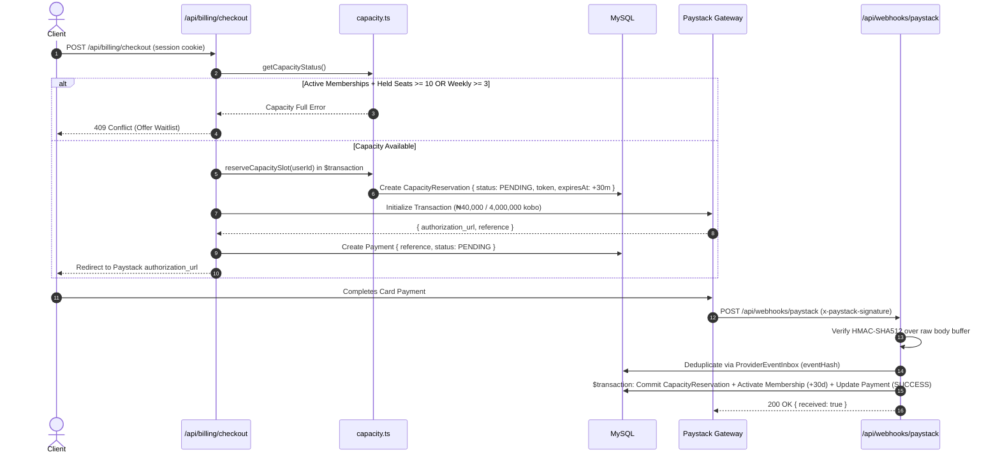
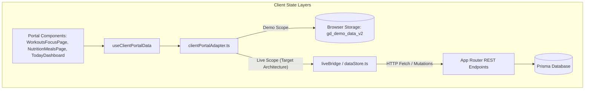

# ASCEND — System Architecture & Component Map

**Platform**: ASCEND — Personalised Online Physique Coaching  
**Lead Architect**: Senior Full-Stack Engineer & Software Architect  
**Documentation Version**: 1.0.0 (Post-Audit Baseline)  
**Database**: MySQL 8.x via Prisma 7.10.1  
**Framework**: Next.js 16.4.6 (App Router + Pages Router hybrid) · React 19 · TypeScript 5.7  

---

## 1. High-Level System Architecture

```mermaid
flowchart TD
    subgraph Client Tier ["Browser / Client Tier"]
        UI_Home["Homepage & Modals<br/>(Tailwind CSS 4)"]
        UI_Auth["Access Shell & OTP<br/>(Register, Verify, Login)"]
        UI_Intake["Nine-Stage Assessment<br/>(Autosave Intake Form)"]
        UI_Portal["Client Portal<br/>(Today, Workouts, Meals, Progress)"]
        UI_Coach["Coach Studio<br/>(Athletes, Drafts, Reviews, Safety)"]
    end

    subgraph Server Tier ["Next.js App Router (Node.js 22+)"]
        API_Auth["/api/auth/*<br/>(Start, Verify, MFA, Logout)"]
        API_Screen["/api/screening<br/>(10-Question Ingestion)"]
        API_Billing["/api/billing/*<br/>(Checkout, Cancel, Callback)"]
        API_Hooks["/api/webhooks/paystack<br/>(HMAC-SHA512 Inbound)"]
        API_Assessment["/api/assessment<br/>(Stage Data & Safety Triage)"]
        API_Account["/api/account/snapshot<br/>(10-State Account Hub)"]
        API_Progress["/api/progress/*<br/>(Observations & Metrics)"]
        API_Achievements["/api/achievements<br/>(8 Groups Definition)"]
        API_Coach["/api/coach/*<br/>(Roster, Program Publishing)"]
    end

    subgraph Service Tier ["Domain Services (src/server/)"]
        S_Auth["auth.ts<br/>(Tokens, Sessions, Snapshots)"]
        S_Cap["capacity.ts<br/>(10-Cap, 3-Weekly, Lagos Wk)"]
        S_Pay["paystack.ts<br/>(Checkout, Verify, 40,000 NGN)"]
        S_Obs["observations.ts<br/>(Idempotency, Replay Check)"]
        S_Chal["challenges.ts<br/>(OTP, Rate-Limits, Hashing)"]
        S_DB["db.ts & prisma.ts<br/>(Prisma Client Instance)"]
    end

    subgraph Data Tier ["MySQL 8.x (Port 3306)"]
        DB_Users[("User, Session, AuthChallenge")]
        DB_Screen[("RegistrantScreening")]
        DB_Member[("Membership, Payment, Capacity")]
        DB_Assess[("ClientAssessment, AssessmentStageData")]
        DB_Program[("ProgrammeDraft, DailyMealLog, WorkoutSetLog")]
        DB_Obs[("Observation, AchievementDefinition/Award")]
    end

    subgraph External Tier ["External Services"]
        EXT_Paystack["Paystack Gateway<br/>(Checkout & Recurring Subscriptions)"]
    end

    %% Client to Server
    UI_Home --> API_Auth
    UI_Auth --> API_Auth
    UI_Auth --> API_Screen
    UI_Auth --> API_Billing
    UI_Intake --> API_Assessment
    UI_Portal --> API_Account
    UI_Portal --> API_Progress
    UI_Portal --> API_Achievements
    UI_Coach --> API_Coach

    %% Server to Service
    API_Auth --> S_Auth & S_Chal
    API_Screen --> S_Cap & S_Auth
    API_Billing --> S_Pay & S_Cap & S_Auth
    API_Hooks --> S_Pay & S_Cap
    API_Assessment --> S_Auth
    API_Account --> S_Auth & S_Cap
    API_Progress --> S_Obs & S_Auth
    API_Coach --> S_Auth

    %% Service to DB
    S_Auth & S_Chal --> DB_Users
    S_Cap --> DB_Member
    S_Pay --> DB_Member
    S_Obs --> DB_Obs
    API_Assessment --> DB_Assess
    API_Coach --> DB_Program
    API_Screen --> DB_Screen

    %% External
    S_Pay <--> EXT_Paystack
    EXT_Paystack --> API_Hooks
```



---

## 2. Next.js Routing Map (App Router vs Pages Router)

The codebase currently contains both App Router (`src/app/`) and legacy Pages Router (`src/pages/`) files:

### Active App Router Hierarchy (`src/app/`)

| Route Path | File Location | Purpose & Guards | Target Scope |
|---|---|---|---|
| `/` | `src/app/page.tsx` | Public landing page; mounts `HomePage` | Public |
| `/register` | `src/app/register/page.tsx` | Client signup form (initiates email OTP) | Public |
| `/verify-email` | `src/app/verify-email/page.tsx` | 6-digit OTP code verification | Public |
| `/login` | `src/app/login/page.tsx` | Existing client login (OTP challenge) | Public |
| `/client-login` | `src/app/client-login/page.tsx` | Direct client access redirect | Public |
| `/coach/login` | `src/app/coach/login/page.tsx` | Coach credential login | Coach Only |
| `/coach/verify` | `src/app/coach/verify/page.tsx` | Coach MFA challenge verification | Coach Only |
| `/coach-portal` | `src/app/coach-portal/page.tsx` | Coach Studio main application hub | Coach Role Required |
| `/coach-portal/[...slug]` | `src/app/coach-portal/[...slug]/page.tsx` | Coach Studio deep-linked views | Coach Role Required |
| `/apply` | `src/app/apply/page.tsx` | Private Nine-Stage Assessment | Authenticated & Paid Client |
| `/assessment` | `src/app/assessment/page.tsx` | Assessment continuation route | Authenticated Client |
| `/account` | `src/app/account/page.tsx` | Client Account Hub (state dispatch) | Authenticated Client |
| `/account/membership` | `src/app/account/membership/page.tsx` | Subscription billing & cancellation | Authenticated Client |
| `/waitlist` | `src/app/waitlist/page.tsx` | Capacity waitlist consent form | Authenticated Client |
| `/client/dashboard` | `src/app/client/dashboard/page.tsx` | Client Portal: Today Tab | Active Coaching Client |
| `/client/workout-logger` | `src/app/client/workout-logger/page.tsx` | Client Portal: Workouts Tab | Active Coaching Client |
| `/client/nutrition` | `src/app/client/nutrition/page.tsx` | Client Portal: Nutrition Tab | Active Coaching Client |
| `/client/progress` | `src/app/client/progress/page.tsx` | Client Portal: Progress Tab | Active Coaching Client |
| `/client/plan` | `src/app/client/plan/page.tsx` | Full programme document overview | Active Coaching Client |
| `/demo/*` | `src/app/demo/*` | Public interactive demo portal | Unauthenticated Demo |

### Redundant Pages Router Files (`src/pages/`)
*To be cleaned up in Milestone 5:*
- `src/pages/public/HomePage.tsx` $\rightarrow$ Replaced by direct App Router import in `src/app/page.tsx`.
- `src/pages/public/ApplicationPage.tsx` $\rightarrow$ Duplicate of `/apply`.
- `src/pages/auth/ClientLoginPage.tsx` $\rightarrow$ Duplicate of `/login`.
- `src/pages/auth/CoachLoginPage.tsx` $\rightarrow$ Duplicate of `/coach/login`.
- `src/pages/coach/CoachPortalPage.tsx` $\rightarrow$ Duplicate of `/coach-portal`.

---

## 3. Database Entity-Relationship Map (Prisma Schema)

The Prisma schema defines 19 relational models in MySQL:

```mermaid
erDiagram
    User ||--o{ Session : "has active"
    User ||--o| RegistrantScreening : "completes 10-question"
    User ||--o| Membership : "holds"
    User ||--o{ Payment : "initiates"
    User ||--o{ CapacityReservation : "reserves"
    User ||--o| WaitlistEntry : "opts into"
    User ||--o| ClientAssessment : "submits"
    User ||--o{ Observation : "logs body metrics"
    User ||--o{ AchievementAward : "earns"
    User ||--o{ DailyMealLog : "records meals"
    User ||--o{ ClientWorkoutSession : "performs"
    User ||--o{ ProgrammeDraft : "assigned"
    User ||--o{ CoachingCheckIn : "submits check-ins"
    User ||--o{ PriorityMessage : "sends priority msgs"

    ClientAssessment ||--o{ AssessmentStageData : "contains 9 stages"

    CapacityPolicy ||--o{ CapacityReservation : "governs"

    AchievementGroup ||--o{ AchievementDefinition : "categorises"
    AchievementDefinition ||--o{ AchievementAward : "unlocks"

    Workout ||--o{ WorkoutSet : "prescribes"
    Exercise ||--o{ WorkoutSet : "references"

    ClientWorkoutSession ||--o{ ClientWorkoutSetLog : "logs working sets"
    Exercise ||--o{ ClientWorkoutSetLog : "references"

    User {
        string id PK
        string email UK
        string passwordHash
        enum role "CLIENT | COACH"
        string timeZone "Africa/Lagos"
        datetime createdAt
    }

    Session {
        string tokenHash PK "SHA-256"
        string userId FK
        datetime expiresAt
        datetime revokedAt
    }

    AuthChallenge {
        string id PK
        string identifier "email"
        string codeHash "SHA-256"
        enum challengeType "CLIENT_EMAIL_OTP | COACH_MFA"
        datetime expiresAt
        int attempts
        int maxAttempts
    }

    RegistrantScreening {
        string id PK
        string userId FK UK
        string firstName
        string whatsappNumber
        string mainGoal
        string gymExperience
        string trainingLocation
        string daysPerWeek
        string ageRange
        string medicalClearance
        string readySevenDays
        enum eligibility "CLEAR | SAFETY_HOLD | GUARDIAN_PENDING | CAPACITY_WAIT"
    }

    Membership {
        string id PK
        string userId FK UK
        enum status "PENDING | ACTIVE_RENEWING | NON_RENEWING | ENDED"
        datetime paidThrough
        string paystackCustomerCode
        string paystackSubscriptionCode
        int priceKobo "4000000"
        boolean cancelAtPeriodEnd
        int priorityMessagesRemaining "2"
        int reviewsRemaining "2"
    }

    CapacityReservation {
        string id PK
        string token UK
        string userId FK
        enum status "PENDING | COMMITTED | EXPIRED"
        string weekKey "YYYY-Www"
        datetime expiresAt "30m TTL"
    }

    ClientAssessment {
        string id PK
        string userId FK UK
        enum status "NOT_STARTED | IN_PROGRESS | SUBMITTED | SAFETY_HELD | APPROVED"
        json safetyFlags
        datetime deliveryDueAt "5 business days"
        datetime submittedAt
    }

    AssessmentStageData {
        string id PK
        string assessmentId FK
        string stageCode "FT, BS, FS, TC, GB, MF, TR, RL, PP"
        json data
        datetime completedAt
    }

    Observation {
        string id PK
        string userId FK
        enum metric "BODYWEIGHT_KG | WAIST_CM"
        decimal value
        datetime measuredAt
        string requestId UK "Idempotency UUID"
        string payloadHash "SHA-256"
        datetime voidedAt "Soft deletion"
    }

    ProviderEventInbox {
        string id PK
        string eventHash UK "SHA-256 of raw webhook"
        string eventType "charge.success"
        json payload
        datetime processedAt
        string outcome
    }
```

---

## 4. Authentication, Sessions & Security Protocol

```mermaid
sequenceDiagram
    autonumber
    actor Client as Client Browser
    participant API as /api/auth/client/*
    participant DB as MySQL (Prisma)
    participant Mail as Email / Dispatcher

    Client->>API: POST /api/auth/client/start { email }
    API->>DB: Check rate limits & 60s cooldown
    API->>DB: Upsert AuthChallenge (hash(6-digit code), expires in 10m)
    API->>Mail: Send single-use 6-digit OTP
    API-->>Client: 200 OK { nextPath: '/verify-email' }

    Client->>API: POST /api/auth/client/verify { email, code }
    API->>DB: Query active challenge & compare hash
    alt Code Valid
        API->>DB: Mark challenge consumed (consumedAt = now)
        API->>DB: Revoke any previous active sessions for user
        API->>DB: Create new Session { tokenHash: sha256(rawToken), expiresAt: +7d }
        API-->>Client: Set-Cookie: ascend_session=rawToken; HttpOnly; SameSite=Lax; Path=/
        API-->>Client: 200 OK { authenticated: true }
    else Invalid Code / Exceeded Attempts
        API->>DB: Increment challenge attempts (lock at 5)
        API-->>Client: 400 Bad Request / 429 Too Many Attempts
    end
```

---

## 5. Paystack Integration & Capacity Control Architecture



---

## 6. Client State Architecture & Adapters



### Storage Key Registry
- `gd_demo_data_v2`: Serialized demo client portal snapshot stored in `sessionStorage`.
- `ascend_login_email`: Client email stored temporarily during OTP verification.
- `ascend_dev_otp`: Development OTP bypass code stored only when `NODE_ENV === 'development'`.
- `ascend_session`: Cryptographic 64-character hex session token stored in `HttpOnly` browser cookie.
