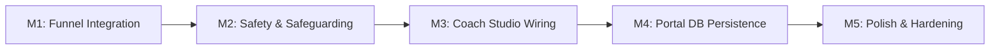

# ASCEND — Implementation Roadmap & Milestone Plan

**Platform**: ASCEND Personalised Online Physique Coaching  
**Lead Architect**: Senior Full-Stack Engineer & Technical Lead  
**Target Architecture**: React 19 · Next.js 16 (App Router) · Prisma 7 · MySQL · Paystack  
**Strategy**: **End-to-End Client Journey First**, followed by Coach Studio Real-Data Wiring, Client Portal Persistence, and Production Hardening.

---

## Roadmap Overview

| Milestone | Focus | Classification | Target Scope |
|---|---|---|---|
| **Milestone 1** | Client Funnel & Payment Integration | **Critical Launch Blocker** | Connect Signup $\rightarrow$ Screening $\rightarrow$ Capacity $\rightarrow$ Payment $\rightarrow$ Assessment |
| **Milestone 2** | Assessment Safety & Safeguarding Directives | **Critical Launch Blocker** | PAR-Q+ complete removal, BS-03 branching, per-stage autosave |
| **Milestone 3** | Coach Studio Live Data & Publishing | **High Priority** | Real athlete rosters, assessment triage, programme publishing |
| **Milestone 4** | Client Portal Live Database Persistence | **High Priority** | Meal logs, workout sets, gesture swipe, nutrition modes |
| **Milestone 5** | Route Cleanup, Achievements & Production Polish | **Polish & Enhancement** | Pure App Router, achievement engine, linting script fix |

---

## Milestone 1: End-to-End Client Funnel Integration

### Objective
Unify the disconnected onboarding pieces into a single, seamless, authenticated client journey:
$$\text{Homepage} \longrightarrow \text{Signup / OTP} \longrightarrow \text{10-Question Screening} \longrightarrow \text{Capacity Check} \longrightarrow \text{Paystack Checkout (₦40,000)} \longrightarrow \text{9-Stage Assessment}$$

### Dependencies
- Existing `AuthChallenge` and OTP verification in `src/server/auth.ts`.
- Existing `CapacityReservation` and `reserveCapacitySlot()` in `src/server/capacity.ts`.
- Existing Paystack checkout initialization in `src/app/api/billing/checkout/route.ts`.
- Existing `RegistrantScreening` model in `prisma/schema.prisma`.

### Code to Reuse
- `RegistrationModal.tsx` UI step components, question wording, and validation rules.
- `RegisterForm.tsx` and `VerifyEmailForm.tsx` for email OTP.
- `src/server/paystack.ts` for checkout URL generation.
- `src/app/api/webhooks/paystack/route.ts` for automated membership activation.

### Files Requiring Changes
1. **New Route**: `src/app/api/screening/route.ts`
   - Accepts authenticated client's 10-question responses.
   - Computes initial eligibility (`CLEAR`, `SAFETY_HOLD`, `EQUIPMENT_HOLD`, `GUARDIAN_PENDING`).
   - Upserts into `prisma.registrantScreening`.
2. **`src/features/ascend/access/VerifyEmailForm.tsx`**:
   - Update line 81: When `context === 'signup'`, check whether the user has already completed screening. If not, redirect to `/register/screening` instead of bypassing to `/apply`.
3. **`src/app/register/screening/page.tsx` (New App Router Page)**:
   - Houses the authenticated 10-question registration flow (adapted from `RegistrationModal.tsx`).
   - Upon completion, calls `POST /api/screening`.
   - On `CLEAR` outcome, checks capacity and redirects to membership checkout.
4. **`src/app/apply/page.tsx`**:
   - Add server-side gate: Verify user has an active paid membership (`membership.status === 'ACTIVE_RENEWING'` or `'NON_RENEWING'`) before mounting `NineStageAssessment`. If unpaid, redirect to `/account/membership`.
5. **`src/app/api/billing/checkout/route.ts`**:
   - Update eligibility checks to allow minors under 16 to record screening with guardian consent rather than throwing `ApiError(403, 'AGE_RESTRICTED_UNDER_16')`.

### Acceptance Criteria
- [ ] User signs up at `/register`, enters email, and verifies 6-digit OTP at `/verify-email`.
- [ ] Verified user is immediately directed to the 10-Question Registration.
- [ ] Screening responses are persisted to the MySQL `RegistrantScreening` table with appropriate eligibility status.
- [ ] Capacity status (10 active founding clients, 3 weekly onboardings) is evaluated in real time.
- [ ] Eligible client is presented with the ₦40,000/month paywall and redirected to Paystack checkout with a valid reservation token.
- [ ] Access to `/apply` is strictly forbidden to unpaid accounts.

### Necessary Automated Tests
- Test 1: Authenticated submission to `POST /api/screening` saves all 10 fields and returns correct eligibility.
- Test 2: Unauthenticated request to `POST /api/screening` fails with 401.
- Test 3: Unpaid client navigating to `/apply` is redirected to `/account/membership`.
- Test 4: Capacity reservation commits upon Paystack webhook success and unlocks `/apply`.

---

## Milestone 2: Assessment Safety & Safeguarding Alignment

### Objective
Enforce all strict medical safety directives, conditional question branching, and progressive autosave throughout the Nine-Stage Private Assessment.

### Dependencies
- Milestone 1 (user must reach `/apply` via authenticated, paid state).
- Prisma models `ClientAssessment` and `AssessmentStageData`.

### Code to Reuse
- `src/features/ascend/public-apply/assessment/NineStageAssessment.tsx` layout and stage UI.
- `src/app/api/assessment/route.ts` for database upserting.

### Files Requiring Changes
1. **`src/features/ascend/public-apply/assessment/assessmentData.ts`**:
   - **Remove PAR-Q/PAR-Q+ entirely**:
     - Replace `BS-01` (`type: 'parq'`) with approved targeted safety question: *"Are you currently managing any medical condition, cardiovascular concern, or prescription that requires restricted physical exertion?"* (`type: 'choice'`, options: `['No', 'Yes', 'Unsure']`).
     - Update `BS-04`: Remove reference *"not already covered in the official PAR-Q+"*.
   - **Fix BS-03 Branching**:
     - Update question `BS-03` (joint symptom flags) to include:
       `when: { id: 'BS-02', in: ['Yes', 'Unsure'] }`.
2. **`src/features/ascend/public-apply/assessment/NineStageAssessment.tsx`**:
   - Remove `'parq'` from type-check handlers at line 494.
   - **Implement Per-Stage Autosave**: In `handleNextStage`, trigger a background non-blocking `fetch('/api/assessment')` whenever a stage is completed, so clients never lose intermediate answers.
   - Pre-populate Stage 1 ("Here's what you told us") with verified answers from `RegistrantScreening`.
3. **`src/features/ascend/coach/CoachStudio.tsx`**:
   - Lines 975 & 982: Remove "PAR-Q+ status" text; replace with "Baseline Safety Review".

### Acceptance Criteria
- [ ] Zero mentions of "PAR-Q" or "PAR-Q+" exist across code, questionnaires, or UI.
- [ ] `BS-03` is hidden when `BS-02` is "No", and only renders when `BS-02` is "Yes" or "Unsure".
- [ ] Navigating between assessment stages automatically saves progress to `AssessmentStageData`.
- [ ] Safety flags (`BS-02: Yes`, `BS-03: Yes`, `BS-06: Pregnant`, `BS-07: Yes`) automatically set assessment status to `SAFETY_HELD`.

### Necessary Automated Tests
- Test 1: Submitting stage data with `BS-02: No` ensures `BS-03` is omitted from required fields.
- Test 2: In-progress assessment retrieves saved intermediate answers on page refresh (`GET /api/assessment`).
- Test 3: Safety-flagged assessment sets `ClientAssessment.status = 'SAFETY_HELD'`.

---

## Milestone 3: Coach Studio Real-Data Wiring & Programme Publishing

### Objective
Replace the in-memory mock client records in Coach Studio with real database-backed athletes, assessment triaging, safety hold management, and atomic programme draft publication.

### Dependencies
- Milestones 1 & 2.
- Prisma models `User`, `ClientAssessment`, `AssessmentStageData`, `ProgrammeDraft`, `CoachingCheckIn`, `PriorityMessage`.

### Code to Reuse
- `src/features/ascend/coach/CoachStudio.tsx` UI components, modal structures, and tab routing.
- `src/server/auth.ts` `requireCoach()` authorization guard.

### Files Requiring Changes
1. **New Route**: `src/app/api/coach/clients/route.ts`
   - Server-guarded endpoint for coach: queries all clients with their screening, membership, assessment, and active programme.
2. **New Route**: `src/app/api/coach/programmes/publish/route.ts`
   - Atomically updates current `ACTIVE` programme to `SUPERSEDED` and sets the target `ProgrammeDraft` to `ACTIVE`.
   - Ensures invariant: **Exactly one active training plan and one active nutrition plan per client**.
3. **New Route**: `src/app/api/coach/safety/route.ts`
   - Allows coach to place or release client safety holds with audit rationale.
4. **`src/features/ascend/coach/CoachStudio.tsx`**:
   - Replace static `INITIAL_CLIENTS`, `INITIAL_TASKS`, `INITIAL_MESSAGES` with `swr` or `fetch` querying `/api/coach/clients`.
   - Wire the "Approve & Publish" action to `POST /api/coach/programmes/publish`.
   - Wire the safety review modal to update real client safety status.

### Acceptance Criteria
- [ ] Coach logging in at `/coach/login` sees real registered athletes who have submitted assessments.
- [ ] Sahmi can inspect all 9 submitted stages with uploaded photos and safety flags.
- [ ] Publishing a programme activates it in the database and links the client's future workout logs to that specific version.
- [ ] AI-generated drafts are strictly prevented from auto-publishing without coach interaction.

### Necessary Automated Tests
- Test 1: Non-coach user attempting to access `/api/coach/clients` receives 403 Forbidden.
- Test 2: Publishing a new programme supersedes the previous active version atomically.
- Test 3: Placing a client on safety hold immediately blocks portal access in `getAccountSnapshot`.

---

## Milestone 4: Client Portal Live Database Persistence

### Objective
Connect the client portal (Today, Workouts, Nutrition, Progress) to Prisma database models so all workout sets, meal confirmations, and check-ins persist permanently.

### Dependencies
- Milestone 3 (published active programme required for workouts and nutrition).
- Prisma models `ClientWorkoutSession`, `ClientWorkoutSetLog`, `DailyMealLog`, `ExerciseSwap`.

### Code to Reuse
- `WorkoutsFocusPage.tsx` Focus Mode and Session Mode UI, rest timer, and swap modals.
- `NutritionMealsPage.tsx` meal cards, gram displays, and Nigerian catalog.
- `useClientPortalData.ts` and `clientPortalAdapter.ts`.

### Files Requiring Changes
1. **New Route**: `src/app/api/workouts/route.ts`
   - Saves completed workout sessions and individual set logs (`loadKg`, `reps`, `isWarmup`, `performedAt`).
2. **New Route**: `src/app/api/nutrition/route.ts`
   - Saves daily meal confirmations (`ate_as_planned`, `changed`, `didnt_eat`, grams eaten, verified vs self-reported).
3. **`src/features/ascend/portal/data/clientPortalAdapter.ts` & `src/services/dataStore.ts`**:
   - Replace the empty no-op stubs (`saveWorkout`, `addFood`) with asynchronous calls to `/api/workouts` and `/api/nutrition`.
4. **`src/features/ascend/portal/pages/WorkoutsFocusPage.tsx`**:
   - Implement horizontal touch swipe gesture (`onTouchStart`, `onTouchEnd` with $\Delta x > 50\text{px}$) to switch between Focus Mode and Session Mode.
   - Demote prominent segmented switcher button as per approved prototype specifications.
5. **`src/features/ascend/portal/pages/NutritionMealsPage.tsx`**:
   - Add top mode switcher: **Simple** (habit-based portions), **Structured** (meal slots with swaps), and **Precision** (gram & macro tracking) without altering billing tiers.

### Acceptance Criteria
- [ ] Completing a workout in Focus Mode or Session Mode saves each working set and warm-up set to `ClientWorkoutSetLog`.
- [ ] Logging a meal ("Ate as planned" or "Changed") persists to `DailyMealLog` for the current calendar date.
- [ ] Workouts tab supports smooth horizontal swipe between Focus Mode and Session Mode.
- [ ] Nutrition tab toggles cleanly between Simple, Structured, and Precision modes.

### Necessary Automated Tests
- Test 1: Workout set log records exact load, reps, and timestamp linked to user ID.
- Test 2: Warm-up sets are flagged `isWarmup: true` and excluded from working-volume totals.
- Test 3: Meal log differentiates between planned prescription and user substitute.

---

## Milestone 5: Routing Cleanup, Achievements & Production Hardening

### Objective
Eliminate architectural ambiguity by removing redundant Pages Router files, connecting the live achievement catalog to real workout PRs, resolving linter script paths, and validating deployment.

### Dependencies
- Milestones 1–4 complete.

### Code to Reuse
- `docs/achievement-source.md` approved 8-group catalog specification.
- `src/contracts/progress.ts`.

### Files Requiring Changes
1. **Eliminate `src/pages/`**:
   - Delete redundant Pages Router files (`src/pages/auth/*`, `src/pages/coach/*`, `src/pages/public/*`).
   - Update `src/app/page.tsx` to directly import `src/features/ascend/public-apply/pages/HomePage.tsx`.
   - Verify `npm run build` compiles only App Router routes (`Route (app)`).
2. **`src/features/ascend/portal/pages/ProgressInteractivePage.tsx`**:
   - Replace `INITIAL_ACHIEVEMENTS` mock array with `fetch('/api/achievements')`.
3. **`package.json`**:
   - Update lint script to handle paths with spaces or install standalone `eslint` in `devDependencies`.
4. **Vercel Deployment Verification**:
   - Run end-to-end smoke test against staging database.

### Acceptance Criteria
- [ ] `npm run build` outputs 0 Pages Router routes; all routes are strictly App Router.
- [ ] Achievements tab renders dynamic awards from the database.
- [ ] `npm run lint` and `npm run check` pass without errors.
- [ ] No git push executed automatically (manual review protocol respected).

---

## Risk Register & Architectural Decisions

| ID | Risk / Decision Point | Impact | Mitigation Strategy |
|---|---|---|---|
| **R-1** | Paystack Webhook Timing vs Client Redirect | User completes Paystack payment but webhook arrives with a 2-second delay while client is redirected. | Frontend callback page displays "Confirming your membership..." spinner and polls `/api/account/snapshot` until `membership.status` is updated. |
| **R-2** | Capacity Race Conditions | Two clients simultaneously check out for the 10th founding slot. | Handled via atomic Prisma `$transaction` in `reserveCapacitySlot()`. Slot is reserved for 30 minutes; second client receives `CAPACITY_FULL_FOUNDING_10` and waitlist option. |
| **R-3** | Incomplete Assessment Autosave | Client closes mobile browser on stage 7; re-opening prompts them to restart from stage 1. | Autosave after each stage advances `AssessmentStageData`; on load, `NineStageAssessment` resumes from the last completed stage. |
| **R-4** | Dual Next.js Router Conflicts | Pages Router wrapper files expose duplicate public endpoints without auth guards. | Remove `src/pages/` completely in Milestone 5. |
