# ASCEND — Complete Repository & Technical Architecture Audit

**Repository**: `https://github.com/Sahmio2/Ascend_Full_Site`  
**Auditor**: Senior Full-Stack Engineer, Software Architect & Technical Lead  
**Audit Date**: November 2026  
**Audited Commit**: `46c86c4` (ahead of `origin/main` by 1 commit)  
**Verification Status**: All tests passing (38/38), TypeScript 0 errors, Next.js build succeeding.  
**Execution Mode**: **AUDIT ONLY. STRICTLY NO DESTRUCTIVE CHANGES OR REBUILDS EXECUTED.**

---

## 1. Executive Summary

ASCEND is designed as an elite, high-touch online physique coaching platform combining tailored resistance training, Nigerian cultural nutrition prescriptions in grams, milestone-based physique achievements, and strict capacity management under head coach Sahmi El.

The repository displays exceptional front-end visual polish and robust backend primitives for authentication, rate limiting, Paystack HMAC webhook verification, and atomic capacity management. However, our comprehensive architectural inspection reveals that **the application currently exists as isolated functional islands**:

1. **The Client Journey is Disconnected**:
   - The approved user flow is:
     $$\text{Homepage} \longrightarrow \text{Signup} \longrightarrow \text{10-Question Screening} \longrightarrow \text{Capacity/Eligibility} \longrightarrow \text{Membership Payment} \longrightarrow \text{9-Stage Assessment} \longrightarrow \text{Sahmi Review} \longrightarrow \text{Approved Plan} \longrightarrow \text{Client Portal}$$
   - In the actual code, a new user registers with email (`/register`), verifies OTP (`/verify-email`), and is immediately redirected to `/apply` (mounting `NineStageAssessment.tsx` directly). This **completely bypasses** the 10-Question Screening, capacity checks, and the ₦40,000/month Paystack paywall.
2. **10-Question Screening Data is Not Persisted**:
   - The 10-question registration form exists solely in `RegistrationModal.tsx` on the Homepage. Its state is stored in React memory and **never transmitted to any server endpoint or database table**. Although `RegistrantScreening` is modeled in Prisma, zero API routes read or write to it.
3. **Specific Domain Rules are Violated**:
   - **PAR-Q/PAR-Q+**: The platform is required to remove PAR-Q/PAR-Q+ entirely. However, `assessmentData.ts` still includes `BS-01` ("Complete the current PAR-Q+ safety screen.") and `BS-04` ("not already covered in the official PAR-Q+"), while `CoachStudio.tsx` still renders "PAR-Q+ status".
   - **BS-03 Conditional Branching**: `BS-03` (joint symptom flags: locking, giving way, swelling) is rendered unconditionally at `assessmentData.ts:70`, whereas requirements mandate it appear **only** when `BS-02` indicates "Yes" or "Unsure".
   - **Under-16 Rule**: `RegistrationModal.tsx` and `/api/billing/checkout` reject applicants under 16 outright, violating the latest directive not to reject under-16s automatically, but to collect age in the 10-question screening and apply guardian consent/safeguarding workflows before paid coaching.
4. **Coach Studio Operates on Mock Data**:
   - `CoachStudio.tsx` (2,201 lines) provides a rich interface for client reviews, assessment triaging, programme drafts, and safety holds, but it is **100% mocked** in client state using `INITIAL_CLIENTS`, `INITIAL_TASKS`, and `INITIAL_MESSAGES`. It does not execute a single HTTP request to fetch real database assessments or publish programme drafts to clients.
5. **Client Portal Dynamic Logging is Decoupled from the Database**:
   - In the live client portal (`/client/dashboard`, `/client/workout-logger`, `/client/nutrition`), meals and workout set completions mutate in-memory state or `sessionStorage` via `clientPortalAdapter.ts`. In `src/services/dataStore.ts`, methods `addFood`, `saveWorkout`, and `saveCheckIn` are literally empty no-op stubs (`notify()`).
6. **Dual Next.js Routing Hierarchy**:
   - Next.js compiles both App Router (`src/app/`) and Pages Router (`src/pages/`) simultaneously. Wrapper files in `src/pages/public/` and `src/pages/auth/` expose redundant public routes and create architectural ambivalence.

---

## 2. Technology Stack Verification

| Intended Stack Requirement | Implemented Version in Repo | Status | Verification & Observations |
|---|---|---|---|
| **React 19** | `react: ^19.0.0`, `react-dom: ^19.0.0` | **MATCH** | Successfully mounted and rendered in all client routes. |
| **TypeScript 5.7** | `typescript: 5.7.3` | **MATCH** | Strict type-checking configured. `npx tsc --noEmit` passes with 0 errors. |
| **Next.js App Router** | `next: 16.4.6` | **PARTIAL** | App Router is implemented in `src/app/`, but Pages Router is also active via `src/pages/`. Next.js compiles both during `npm run build`. |
| **Tailwind CSS 4** | `@tailwindcss/postcss: ^4.0.0`, `tailwindcss: ^4.0.0` | **MATCH** | Tailwind 4 with `@import "tailwindcss";` in `src/globals.css`. |
| **Prisma ORM** | `prisma: 7.10.1`, `@prisma/client: 7.10.1` | **MATCH** | Schema has 19 models; output generated to `src/generated/prisma`. |
| **MySQL Database** | Local MySQL (port 3306) | **MATCH** | Connected via `DATABASE_URL="mysql://root@localhost:3306/ascend"`. Migration `202611130001_initial` applied. |
| **Typed Stores** | `zustand: ^5.0.0` | **PARTIAL** | Zustand is used in `src/stores/progress.ts`. However, client portal state is split between custom event emitters in `clientPortalAdapter.ts` and `dataStore.ts`. |
| **Vercel Deployment** | `vercel.json` | **MATCH** | Standard Vercel configuration present. |

### Build & Environment Diagnostic Results
- **Type Check (`npx tsc --noEmit`)**: **PASSED** (0 errors).
- **Prisma Validate & Generate (`npm run check`)**: **PASSED** (Schema valid, client generated).
- **Automated Test Suite (`npm test`)**: **PASSED** (38/38 tests passing across `access-auth`, `billing-capacity`, `endpoints`, `http-server`, `integration`, and `progress`).
- **Production Build (`npm run build`)**: **PASSED** (Compiled in 15.9s; static generation 48/48 routes passed).
- **Database Migration (`npx prisma migrate status`)**: **PASSED** (`Database schema is up to date! 1 migration found: 202611130001_initial`).
- **Linter (`npm run lint`)**: **FAILED** (`next lint` failed due to an unquoted space in the path `/Users/macbook/Desktop/WEb sites/Ascend_Full_Site/lint` and missing standalone `eslint` in `devDependencies`).

---

## 3. End-to-End Client Journey Audit

The required 9-stage sequence versus the repository implementation:

```mermaid
flowchart TD
    subgraph Approved Specification
        S1[1. Homepage] --> S2[2. Signup Account]
        S2 --> S3[3. 10-Question Screening]
        S3 --> S4[4. Eligibility & Capacity Check]
        S4 --> S5[5. Paystack Membership Paywall]
        S5 --> S6[6. 9-Stage Private Assessment]
        S6 --> S7[7. Coach Sahmi Review]
        S7 --> S8[8. Approved Programme Published]
        S8 --> S9[9. Client Portal Live]
    end

    subgraph Actual Code Implementation
        A1[Homepage /] -. "Modal (Unpersisted)" .-> A3[10 Questions in React Memory]
        A2[Register /register] --> A2V[Verify Email /verify-email]
        A2V -- "BYPASSES SCREENING & PAYWALL" --> A6[Private Assessment /apply]
        A6 --> A6DB[(DB: ClientAssessment)]
        A6DB -. "DISCONNECTED" .-> A7[Coach Studio: Mock Clients Only]
        A7 -. "DISCONNECTED" .-> A9[Client Portal: LocalStorage/DemoSeed]
    end
```

### Detailed Stage Breakdown

#### Stage 1: Signup & Email Verification
- **Code**: `src/features/ascend/access/RegisterForm.tsx`, `VerifyEmailForm.tsx`, `src/app/api/auth/client/start/route.ts`, `src/app/api/auth/client/verify/route.ts`.
- **Status**: **Implemented**.
- **Evidence**: Uses `AuthChallenge` with `CLIENT_EMAIL_OTP`, SHA-256 hashed 6-digit codes, 5-attempt brute-force protection, 60s resend cooldown, session token rotation, and `HttpOnly` cookie issuance.
- **Flaw**: Upon successful verification in `VerifyEmailForm.tsx:81-84`, when `context === 'signup'`, the client is unconditionally redirected to `/apply`, bypassing the 10-question registration and payment gates.

#### Stage 2: First 10-Question Registration
- **Code**: `src/features/ascend/public-apply/components/RegistrationModal.tsx`, `prisma/schema.prisma` (`RegistrantScreening`).
- **Status**: **Disconnected / Not Persisted**.
- **Evidence**: The modal contains all 10 questions (physique goal, gym experience, training location, training frequency, age range, medical clearance, 7-day start readiness, first name, WhatsApp number, email).
- **Flaws**:
  1. The modal is only triggered from `HomePage.tsx`. It is not part of the authenticated `/register` flow.
  2. Submitting the modal does not call any backend API route. Answers are never written to `RegistrantScreening`.
  3. Clicking "Proceed to Private Assessment" simply links to `/apply`. If the user is unauthenticated, `/apply` bounces them to `/register`, causing them to lose their answers.
  4. Automatic Under-16 Rejection: `RegistrationModal.tsx:216-219` immediately terminates applicants under 16 with an error screen, contradicting the latest requirement to collect age and retain minor safeguarding/guardian consent before paid coaching.

#### Stage 3: Eligibility & Capacity Checks
- **Code**: `src/server/capacity.ts`, `src/app/api/billing/checkout/route.ts`.
- **Status**: **Implemented on Backend / Disconnected from UI**.
- **Evidence**: `getCapacityStatus` strictly calculates active memberships plus pending reservations against `maxActiveClients` (10) and `maxWeeklyOnboardings` (3) in `Africa/Lagos` timezone.
- **Flaw**: Because the onboarding flow skips `/api/billing/checkout`, capacity is never checked before the user fills out the 9-stage assessment.

#### Stage 4: Membership Payment Paywall
- **Code**: `src/app/api/billing/checkout/route.ts`, `src/app/api/webhooks/paystack/route.ts`, `src/features/ascend/access/MembershipBilling.tsx`.
- **Status**: **Backend Implemented / Funnel Disconnected**.
- **Evidence**: Checkout creates a 30-minute `CapacityReservation` token and initializes Paystack for ₦40,000 (4,000,000 kobo). The webhook verifies HMAC-SHA512 raw signatures, deduplicates via `ProviderEventInbox`, commits the capacity slot in a transaction, and activates `Membership`.
- **Flaw**: There is no client-facing paywall step between registration and assessment. `/apply` allows any authenticated user to enter the private assessment without a paid membership.

#### Stage 5: Private Nine-Stage Assessment
- **Code**: `src/features/ascend/public-apply/assessment/NineStageAssessment.tsx`, `assessmentData.ts`, `src/app/api/assessment/route.ts`.
- **Status**: **Partial & Violates Safety Directives**.
- **Evidence**: Renders 9 stages (Foundations, Baseline Safety, Focus & Scope, Training Context, Gym & Blueprint, Movement Selection, Table & Recovery, Real Life, Preparation & Photos). `POST /api/assessment` upserts `ClientAssessment` and groups stage data into `AssessmentStageData`.
- **Flaws**:
  1. **Autosave Deficiency**: State is saved to `/api/assessment` only upon final completion (`NineStageAssessment.tsx:184`). If the user leaves midway, progress is lost.
  2. **PAR-Q+ Rule Violation**: Question `BS-01` (`assessmentData.ts:62`) requires "Complete the current PAR-Q+ safety screen" with type `'parq'`, and `BS-04` (`assessmentData.ts:71`) references the "official PAR-Q+". This directly violates the directive: *Remove PAR-Q/PAR-Q+ entirely from ASCEND's questionnaires, validation requirements and workflow*.
  3. **BS-03 Branching Violation**: Question `BS-03` (joint symptom flags) is rendered unconditionally (`assessmentData.ts:70`). It must be conditioned with `when: { id: 'BS-02', in: ['Yes', 'Unsure'] }`.
  4. **Emergency Contact Input**: In Stage 9, emergency contact details are handled within `NineStageAssessment.tsx`, but no guardian verification workflow is linked for minors.

#### Stage 6: Sahmi's Review (Coach Studio)
- **Code**: `src/features/ascend/coach/CoachStudio.tsx`, `CoachDashboard.tsx`, `coachPortalAdapter.ts`.
- **Status**: **100% Mocked**.
- **Evidence**: The Coach Studio UI is elaborate (athletes table, assessment detail, task list, programme editor, safety review). However, lines 126–159 of `CoachStudio.tsx` hardcode mock records (`INITIAL_CLIENTS`: Amara Okafor, Tunde Adebayo, Zara Bello, Femi Adeyemi, Kemi Musa, Dara Nwosu).
- **Flaw**: Coach Studio has zero API calls to `GET /api/assessment` or database tables. When a real client submits an assessment, it never appears in Coach Studio.

#### Stage 7: Programme Approval & Publishing
- **Code**: `src/features/ascend/coach/CoachStudio.tsx`.
- **Status**: **Missing Backend Persistence**.
- **Evidence**: Clicking "Approve & Publish Programme" in Coach Studio modifies local React component state. There is no API route (`POST /api/coach/programmes/publish`) to create a `ProgrammeDraft` with `status: ACTIVE` in MySQL.

#### Stage 8: Client Portal Live Access
- **Code**: `src/features/ascend/portal/`, `src/app/client/dashboard/page.tsx`, `src/server/auth.ts` (`getAccountSnapshot`).
- **Status**: **Partial / Mock-Bridged**.
- **Evidence**: `getAccountSnapshot` correctly checks if `membership.status` is active and assessment is approved before granting `clientPortalAccess: true`. However, inside the portal, `clientPortalAdapter.ts` falls back to `demoSeed.ts` in `sessionStorage` because `liveBridge` is never connected to database endpoints.

---

## 4. Client Portal Audit

### Today Dashboard (`TodayDashboard.tsx`)
- **Approved Prototype Match**: High. Renders greeting, active phase badge, "Next Action" primary card, weekly training summary dots, daily nutrition progress bar, coach announcement card, and check-in prompt.
- **Data Source**: Pulls from `useClientPortalData(scope)`. When `scope === 'live'`, it falls back to `demoSeed.ts` in `sessionStorage`.
- **Account State Handling**: Partially handles state via `AccountOverview.tsx`, but does not dynamically update if coach places a client on safety hold during active coaching.

### Workouts Tab (`WorkoutsFocusPage.tsx`)
- **Approved Prototype Match**: High fidelity.
- **Implemented Features**:
  - Full Body A/B/C beginner programme structure.
  - Weekly schedule and Workout Preview.
  - Focus Mode v1.0 (compact card showing current movement, warm-up drawer, rest timer, previous session reference, weight/rep inputs).
  - Session Mode displaying all working sets.
  - Warm-up tracking separated from working sets (`isWarmup: true`).
  - Automatic rest timer using prescribed durations (e.g., 120s, 150s).
  - Sahmi-approved exercise substitution modal.
- **Flaws & Missing Requirements**:
  1. **Mode Switching**: The prototype requires horizontal swipe to switch between Focus Mode and Session Mode without a prominent segmented switch. Currently, it uses a prominent toggle button: `<button className="smallmode">FOCUS MODE</button>`. Touch swipe event handlers (`onTouchStart`, `onTouchEnd`) are missing.
  2. **Persistence**: Completed sets and sessions call `clientPortalAdapter.saveWorkout`, which calls `dataStore.saveWorkout()`. In `src/services/dataStore.ts:279`, `saveWorkout` is an empty no-op. Completed workouts are never saved to Prisma `ClientWorkoutSession` or `ClientWorkoutSetLog`.

### Nutrition Tab (`NutritionMealsPage.tsx`)
- **Approved Prototype Match**: High fidelity.
- **Implemented Features**:
  - Today's Meals interface with breakfast, lunch, dinner, extras.
  - Grams-only prescriptions (e.g., "Oats: 60 g", "Cooked rice: 180 g", "Prepared eba: 220 g").
  - Raw and cooked food state labels (`Dry`, `Cooked`, `Prepared`, `Finished recipe`).
  - Nigerian food catalogue (11 staple foods with verified macros per 100g).
  - Three recording choices: `✓ Ate as planned`, `Log substitute / change`, `Didn't eat`.
- **Flaws & Missing Requirements**:
  1. **Simple, Structured, Precision Modes**: The page only supports the Structured view. Mode switching between Simple (habit/portion-based), Structured (meal slots with swaps), and Precision (strict macro/gram tracking) is completely absent.
  2. **Persistence**: Recording meals calls `clientPortalAdapter.addFood`, which routes to `src/services/dataStore.ts:275` `addFood()`, an empty no-op. Food logs are never written to `DailyMealLog` in MySQL.

### Progress Tab (`ProgressInteractivePage.tsx`)
- **Approved Prototype Match**: High fidelity.
- **Implemented Features**:
  - Bodyweight tracking chart and log table connected to live Prisma endpoints (`/api/progress` and `/api/progress/observations`).
  - Idempotent observation logging with `requestId` replay prevention and soft deletion.
  - Approved 8 achievement categories displayed in filter pills: *The Iron Total, Forge, Rise, Balance, Beyond, The Practice, Mastery, The Path*.
- **Flaws & Missing Requirements**:
  1. Achievements UI uses hardcoded `INITIAL_ACHIEVEMENTS` array. It does not fetch `/api/achievements`.
  2. Automatic award evaluation engine is disabled (`automaticAwardsEnabled: false` in `/api/achievements/route.ts`).
  3. No qualifying computation links workout set logs to lift thresholds (e.g., Forge bench press 40 kg or Rise 1 strict pull-up).

---

## 5. Coach Studio Audit

| Area | Current Implementation | Status | Deficit / Architectural Risk |
|---|---|---|---|
| **Coach Auth** | Route protection in `src/server/auth.ts` (`requireCoach`) checks `role === 'COACH'`. | **Partial** | Studio UI routes under `/coach-portal` do not enforce `requireCoach` on server component load. |
| **Athletes Roster** | Renders 6 hardcoded clients with goal, status tone, plan version, and review dates. | **Mocked** | Does not query Prisma `User` table for registered clients. |
| **Assessment Review** | Detailed stage inspection modal for client "Amara Okafor". | **Mocked** | Does not read `ClientAssessment` or `AssessmentStageData` from MySQL. |
| **Safety Holds** | "Safety review" banner and hold status toggles in UI. | **Mocked** | Modifying hold status does not update `ClientAssessment.status` or `RegistrantScreening.eligibility` in the database. |
| **Programme Editor** | Form for editing exercises, sets, reps, rest intervals, and meals. | **Mocked** | Changes only exist in component state; no versioned `ProgrammeDraft` records are created. |
| **Approval & Publication** | "Approve & Publish" button triggers a toast notification. | **Mocked** | Does not execute an atomic transition `Draft -> Active -> Superseded`. |
| **Check-Ins & Inbox** | Priority messages and midpoint check-in tabs with simulated replies. | **Mocked** | Does not connect to `CoachingCheckIn` or `PriorityMessage` database tables. |
| **Capacity Dashboard** | Displays "6 of 10 active clients". | **Mocked** | Hardcoded count; does not call `getCapacityStatus()`. |

---

## 6. Payments, Memberships & Capacity Audit

| Requirement | Implementation in Repo | Status | Verification & Evidence |
|---|---|---|---|
| **Price Point** | ₦40,000 / month (4,000,000 kobo) | **Implemented** | Constant `ASCEND_MONTHLY_PRICE_KOBO = 4000000` in `src/server/paystack.ts`. |
| **Capacities** | Max 10 active clients, Max 3 onboardings/week | **Implemented** | `CapacityPolicy` model with `maxActiveClients: 10`, `maxWeeklyOnboardings: 3`. Verified by `billing-capacity.test.ts`. |
| **Paystack Checkout** | `POST /api/billing/checkout` | **Implemented** | Generates reference, reserves capacity slot, calls Paystack API, creates pending `Payment`. |
| **Webhook Verification** | `POST /api/webhooks/paystack` | **Implemented** | Verifies HMAC-SHA512 over raw buffer; returns 401 on tampered signature. Verified by tests. |
| **Webhook Idempotency** | `ProviderEventInbox` table | **Implemented** | Hashes raw payload to `eventHash`; duplicate deliveries return `{ received: true, alreadyProcessed: true }`. |
| **Cancellation Flow** | `POST /api/billing/cancel` | **Implemented** | Updates `Membership.cancelAtPeriodEnd = true`; retains access until `paidThrough`. |
| **Waitlist Handling** | `POST /api/waitlist` | **Implemented** | Records waitlist opt-in when capacity is full. |
| **Onboarding Paywall Gate** | Client redirected to checkout before assessment | **Missing** | Flow gap: `/verify-email` routes directly to `/apply` without triggering checkout. |

---

## 7. Security, Authorization & Reliability Audit

### Authentication & Sessions
- **Session Tokens**: Generated via `crypto.randomBytes(32)` (64-character hex). Stored in the database as SHA-256 hashes (`tokenHash`). Raw tokens never touch the database.
- **Cookies**: Flagged `HttpOnly`, `SameSite=Lax`, `Path=/`, and `Secure` in production.
- **Session Rotation**: Previous active sessions for a user are explicitly revoked upon new session issuance (`src/server/auth.ts:58-65`).
- **Timing Attacks**: OTP and MFA code verification uses constant-time string comparisons.

### Authorization & Access Control
- **Cross-Client Isolation**: Verified in tests (`tests/endpoints.test.ts` and `tests/http-server.test.ts`). Route queries enforce `ownedRecord(userId, id)` predicates.
- **Coach Role Protection**: `requireCoach()` verifies `user.role === 'COACH'`.
- **Architectural Risk (Dual Routing)**: `src/pages/auth/ClientLoginPage.tsx` and `src/pages/coach/CoachPortalPage.tsx` are exposed as Pages Router routes without middleware route guards, bypassing App Router layout checks.

---

## 8. Feature-by-Feature Classification Table

| Feature | Status | Existing Files | Evidence | Problem | Recommended Action | Priority |
|---|---|---|---|---|---|---|
| **Client OTP Registration** | Implemented | `RegisterForm.tsx`, `api/auth/client/start`, `api/auth/client/verify` | 38 tests passing | Only captures email; skips screening form | Connect to 10-question registration | High |
| **10-Question Screening Form** | Partial | `RegistrationModal.tsx`, `prisma/schema.prisma` | Full UI in modal, DB model defined | Answers in React memory; no API endpoint | Create `POST /api/screening` & connect to DB | Critical |
| **Minor Safeguarding Gate** | Partial | `RegistrationModal.tsx`, `checkout/route.ts` | Code checks `ageRange` | Automatically rejects under-16; blocks registration | Allow screening, trigger guardian consent hold | High |
| **Capacity Enforcement** | Implemented | `server/capacity.ts`, `billing-capacity.test.ts` | Tests prove 10-cap and 3-weekly limit | Disconnected from UI registration | Wire capacity check into screening outcome | High |
| **Paystack Checkout** | Implemented | `api/billing/checkout/route.ts`, `server/paystack.ts` | Full HMAC & reservation logic | Never called before `/apply` | Require payment before `/apply` access | Critical |
| **Paystack Webhook** | Implemented | `api/webhooks/paystack/route.ts` | Durable inbox deduplication | None on backend | Ensure frontend polls or listens for status | Medium |
| **9-Stage Intake Form** | Partial | `NineStageAssessment.tsx`, `api/assessment/route.ts` | 9 stages rendered, DB upsert working | Autosave only on final submit; losing draft work | Autosave on every stage navigation | High |
| **Safety Questions Branching** | Partial | `assessmentData.ts:70` | `BS-03` question exists | `BS-03` rendered unconditionally | Add `when: { id: 'BS-02', in: ['Yes', 'Unsure'] }` | Critical |
| **PAR-Q+ Removal** | Missing / Violates Rule | `assessmentData.ts:62,71`, `CoachStudio.tsx:975` | Question `BS-01` has type `'parq'` | Mentions PAR-Q+ explicitly | Remove PAR-Q+ questions and UI references | Critical |
| **Coach Studio Dashboard** | Mocked | `CoachStudio.tsx`, `CoachDashboard.tsx` | 2,201 lines UI | Uses `INITIAL_CLIENTS` mock array | Create `/api/coach/clients` querying Prisma | High |
| **Programme Approval Lifecycle** | Mocked | `CoachStudio.tsx` | Approval button exists | Modifies local state only; no DB persistence | Create `/api/coach/programmes/publish` | High |
| **Workouts Focus Mode** | Implemented | `WorkoutsFocusPage.tsx` | Full Body A/B/C, sets, rest timer, swaps | Swiping missing; segmented toggle button used | Add touch swipe gesture listener | Medium |
| **Workout Logging Persistence** | Mocked | `WorkoutsFocusPage.tsx`, `dataStore.ts:279` | UI inputs present | `saveWorkout` is an empty no-op | Save sets to `ClientWorkoutSetLog` via API | High |
| **Nigerian Nutrition Meals** | Implemented | `NutritionMealsPage.tsx` | Grams-only, Nigerian catalog, 3 choices | Missing Simple/Structured/Precision modes | Add mode switcher without tier changes | Medium |
| **Meal Logging Persistence** | Mocked | `NutritionMealsPage.tsx`, `dataStore.ts:275` | Meal cards & action buttons present | `addFood` is an empty no-op | Save logs to `DailyMealLog` via API | High |
| **Bodyweight & Waist Tracking** | Implemented | `api/progress/route.ts`, `ProgressInteractivePage.tsx` | Tested DB persistence with idempotency | None | Fully operational | Low |
| **Achievements Display** | Mocked | `ProgressInteractivePage.tsx` | 8 categories styled | Uses `INITIAL_ACHIEVEMENTS` static array | Wire to `GET /api/achievements` | Medium |
| **Achievement Qualification Engine** | Missing | `api/achievements/route.ts` | `automaticAwardsEnabled: false` | No background worker evaluates PRs | Implement PR lift threshold checker | Low |
| **Waitlist Handling** | Implemented | `api/waitlist/route.ts`, `WaitlistConsentForm.tsx` | Stores opt-in proof | None | Fully operational | Low |
| **Account Hub** | Implemented | `AccountOverview.tsx`, `api/account/snapshot` | Handles all 10 account lifecycle states | None | Fully operational | Low |
| **App/Pages Router Separation** | Partial | `src/pages/`, `src/app/` | Both build successfully | Exposes redundant public routes | Eliminate `src/pages` wrapper files | Medium |
