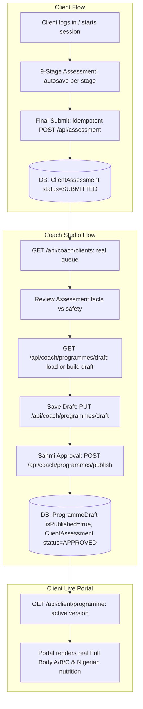

# ASCEND — Milestone 01 Codebase Audit Report

**Date**: November 14, 2026  
**Auditor**: Senior Full-Stack Engineer & Antigravity Agent  
**Branch**: `feature/slice-01-coach-approval` (branched from `main` @ `31844c6`)  
**Repository**: `https://github.com/Sahmio2/Ascend_Full_Site`  
**Execution Mode**: **READ-ONLY AUDIT. ZERO CODE MUTATIONS OR DESTRUCTIVE DB COMMANDS.**

---

## 1. Executive Summary & Objective

The objective of **ASCEND Milestone 01 (Slice 01)** is to establish the first secure end-to-end workflow:
$$\text{Submitted 9-Stage Assessment} \longrightarrow \text{Coach Home Queue} \longrightarrow \text{Assessment Review} \longrightarrow \text{Editable Training / Nutrition Drafts} \longrightarrow \text{Sahmi's Explicit Approval} \longrightarrow \text{Active Client Programmes}$$

This audit assesses the current real code implementation across:
1. Authentication & Role Authorization
2. Client Registration & 10-Question Screening
3. Nine-Stage Intake Assessment
4. Coach Studio v1 (Approved Prototype vs Code)
5. Prisma ORM & MySQL Database State
6. Client Portal Live Data Wiring
7. Sandbox Payment & Membership Fixtures

---

## 2. Technology Stack Verification

| Core Component | Specified / Required | Actual Repository Code | Status | Verification Evidence |
|---|---|---|---|---|
| **React** | React 19 | `react: ^19.0.0`, `react-dom: ^19.0.0` | **MATCH** | Successfully installed and rendered across App Router and components. |
| **TypeScript** | TS 5.7 | `typescript: 5.7.3` | **MATCH** | Strict type-checking configured. `npm run typecheck` (`tsc --noEmit`) passes with 0 errors. |
| **Next.js** | Next.js 16 App Router | `next: 16.4.6` | **MATCH (WITH DUAL ROUTING)** | App Router under `src/app/`. Legacy Pages Router under `src/pages/` is also compiled by Next.js. |
| **Tailwind CSS** | Tailwind CSS 4 | `@tailwindcss/postcss: ^4.0.0`, `tailwindcss: ^4.0.0` | **MATCH** | Uses `@import "tailwindcss";` in `src/globals.css`. |
| **Prisma ORM** | Prisma 7.10 | `prisma: 7.10.1`, `@prisma/client: 7.10.1` | **MATCH** | Schema loaded from `prisma/schema.prisma`; client generated to `src/generated/prisma`. `npx prisma validate` passes. |
| **MySQL Database** | MySQL 8 / MariaDB (Local Port 3306) | Local MySQL via `@prisma/adapter-mariadb` | **MATCH** | Connected via `DATABASE_URL="mysql://root:@127.0.0.1:3306/ascend"`. 27 core tables exist and are verified. |
| **Typed Stores** | Zustand & Custom Stores | `zustand: ^5.0.0`, `useSyncExternalStore` | **MATCH** | Zustand in `src/stores/progress.ts`. Client portal uses `useSyncExternalStore` via `useClientPortalData.ts`. |

### Diagnostic Execution Results
- `npm run check` (`prisma validate && prisma generate && tsc --noEmit`): **PASSED** (0 errors).
- `npx prisma migrate status`: **PASSED** (`Database schema is up to date! 1 migration found: 202611130001_initial`).
- `npm test` (`node --import tsx --test tests/*.test.ts`): **PASSED (38/38 tests passing)** across `access-auth`, `billing-capacity`, `endpoints`, `http-server`, `integration`, and `progress`.

---

## 3. Subsystem Audit & Reality Matrix

### A. Authentication & Role Authorization
- **Files**:
  - `src/server/auth.ts`
  - `src/server/http.ts`
  - `src/app/api/auth/client/start/route.ts`
  - `src/app/api/auth/client/verify/route.ts`
  - `src/app/api/auth/coach/start/route.ts`
  - `src/app/api/auth/coach/verify/route.ts`
  - `src/app/api/auth/logout/route.ts`
  - `src/components/ProtectedRoute.tsx`
- **State**: **Implemented & Tested**.
- **Evidence**:
  - Client authentication uses `AuthChallenge` with `CLIENT_EMAIL_OTP`, SHA-256 hashed 6-digit codes, 60s cooldown, 5-attempt rate limit, and session token rotation.
  - Coach authentication uses `coach/start` verifying password hash followed by `coach/verify` verifying MFA 6-digit challenge.
  - Server route helpers `requireUser(request)` and `requireCoach(request)` securely extract `ascend_session` cookie and enforce database session validity and role checks.
- **Deficit / Gap**:
  - While server helpers exist, there are currently **zero coach-specific API route handlers** for fetching real clients, reviewing real assessments, saving drafts, or publishing plans.

### B. Registration & 10-Question Screening
- **Files**:
  - `src/features/ascend/public-apply/components/RegistrationModal.tsx`
  - `src/features/ascend/access/RegisterForm.tsx`
  - `prisma/schema.prisma` (`model RegistrantScreening`)
- **State**: **Partial / Disconnected from Database**.
- **Evidence**:
  - `RegistrationModal.tsx` contains the complete 10-question sequence (physique goal, gym experience, training location, days per week, age range, medical clearance, ready in 7 days, first name, WhatsApp, email).
  - Answers are held purely in React component state. No network request is dispatched upon completion.
  - **Rule Mismatch**:
    1. `RegistrationModal.tsx:216-219` immediately rejects applicants under 16 with an error screen, contradicting the latest directive: *No special under-16 signup form or automatic under-16 rejection. Age captured once in initial ten-question registration; any applicable minor permissions/safety requirements remain under qualified review.*
    2. Answers are not persisted to the Prisma `RegistrantScreening` table.

### C. Nine-Stage Private Assessment
- **Files**:
  - `src/features/ascend/public-apply/assessment/NineStageAssessment.tsx`
  - `src/features/ascend/public-apply/assessment/assessmentData.ts`
  - `src/app/api/assessment/route.ts`
  - `src/app/apply/page.tsx`, `src/app/assessment/page.tsx`, `src/app/client/assessment/page.tsx`
- **State**: **Partial / Rule Violations Present**.
- **Evidence**:
  - 9 stages are fully rendered: Foundations (FT), Baseline Safety (BS), Focus & Scope (FS), Training Context (TC), Gym & Blueprint (GB), Movement Selection (MF), Table & Recovery (TR), Real Life (RL), Preparation & Photos (PP).
  - `POST /api/assessment` computes delivery due date (+5 business days in Lagos time) and writes `ClientAssessment` and `AssessmentStageData` into MySQL.
- **Deficits & Required Fixes**:
  1. **PAR-Q / PAR-Q+ References Violate Core Directive**:
     - `assessmentData.ts:62` contains `BS-01`: "Complete the current PAR-Q+ safety screen." of type `'parq'`.
     - `assessmentData.ts:71` contains `BS-04`: "...not already covered in the official PAR-Q+?".
     - *Mandate*: PAR-Q and PAR-Q+ must be removed entirely from questions, types, and UI.
  2. **BS-03 Conditional Branching**:
     - `BS-03` (joint locking, swelling, numbness) is rendered unconditionally at `assessmentData.ts:70`. It must only appear if `BS-02` is "Yes" or "Unsure" (`when: { id: 'BS-02', in: ['Yes', 'Unsure'] }`).
  3. **Autosave Deficit**:
     - `NineStageAssessment.tsx:184` only dispatches `POST /api/assessment` when the final stage is submitted. Navigating between stages does not persist drafts to MySQL.
  4. **Initial Load Hydration**:
     - `NineStageAssessment.tsx` checks `localStorage` instead of querying `GET /api/assessment` to restore existing answers for an authenticated client.

### D. Coach Studio v1 (Approved Notion Prototype)
- **Files**:
  - `src/features/ascend/coach/CoachStudio.tsx` (2,201 lines)
  - `src/features/ascend/coach/CoachDashboard.tsx`
  - `src/app/coach-portal/page.tsx`, `src/app/coach-portal/[...slug]/page.tsx`
  - `src/styles/ascend-coach-studio.css`
- **State**: **Mocked in Client Component State**.
- **Evidence**:
  - High fidelity UI matching the approved Coach Studio v1 prototype.
  - However, all data is hardcoded:
    - `INITIAL_CLIENTS` (Amara Okafor, Tunde Adebayo, Zara Bello, Femi Adeyemi, Kemi Musa, Dara Nwosu).
    - `INITIAL_TASKS` (mock task queue).
    - `INITIAL_TRAINING` (mock exercise list).
    - `INITIAL_NUTRITION` (mock meal items).
  - Lines 975–984 render "PAR-Q+ status" and references to PAR-Q+ records in the Safety review tab.
  - The "Simulate publish" button at line 2043 only updates local React state (`setPlanApproved(true)`) with toast `"Publication simulated only · no real plan changed"`. Zero database mutations or API calls occur.

### E. Prisma ORM & MySQL Database State
- **Files**:
  - `prisma/schema.prisma`
  - `prisma/migrations/202611130001_initial/migration.sql`
  - `src/server/db.ts`
- **State**: **Fully Operational on Local MySQL**.
- **Evidence**:
  - Verified 27 tables live in local MySQL database `ascend` on `127.0.0.1:3306`.
  - Core models for Slice 01 are already present:
    - `User`: has `role` (CLIENT / COACH), `timeZone`, and relations to `assessment`, `programmes`, `membership`.
    - `ClientAssessment`: has `userId`, `status` (`NOT_STARTED`, `IN_PROGRESS`, `SAFETY_HELD`, `SUBMITTED`, `APPROVED`), `safetyFlags`, `deliveryDueAt`, `submittedAt`.
    - `AssessmentStageData`: has `assessmentId`, `stageCode`, `data` (JSON), `completedAt`.
    - `ProgrammeDraft`: has `clientUserId`, `version`, `isPublished`, `trainingJson`, `nutritionJson`, `coachNotes`, `publishedAt`.
    - `Membership`: has `status`, `paidThrough`, `priceKobo`.
    - `RegistrantScreening`: has `firstName`, `whatsappNumber`, `mainGoal`, `gymExperience`, `trainingLocation`, `daysPerWeek`, `ageRange`, `medicalClearance`, `readySevenDays`, `eligibility`.

### F. Client Portal Live Data Wiring
- **Files**:
  - `src/features/ascend/portal/data/clientPortalAdapter.ts`
  - `src/features/ascend/portal/data/useClientPortalData.ts`
  - `src/features/ascend/portal/data/demoSeed.ts`
  - `src/features/ascend/portal/data/types.ts`
  - `src/features/ascend/portal/pages/TodayDashboard.tsx`
  - `src/features/ascend/portal/pages/WorkoutsFocusPage.tsx`
  - `src/features/ascend/portal/pages/NutritionMealsPage.tsx`
  - `src/app/client/dashboard/page.tsx`
- **State**: **Partial / Falling Back to Demo Seed**.
- **Evidence**:
  - `TodayDashboard.tsx`, `WorkoutsFocusPage.tsx`, and `NutritionMealsPage.tsx` call `useClientPortalData(scope)`.
  - In `clientPortalAdapter.ts:89-93`, when `scope === 'live'`, if `liveBridge` returns demo data, it falls back to `demoSeed.ts`.
  - There is currently no endpoint `/api/client/programme` for the client portal to load the coach-approved `ProgrammeDraft` from MySQL.
  - The client portal does not yet dynamically distinguish:
    1. `no active plan` / `awaiting review`
    2. `safety hold`
    3. `active approved plan`

### G. Development Test Environment & Test Accounts
- **Test Accounts**:
  - Coach: `coach_test@test.internal` (Role: `COACH`, password verified in `access-auth.test.ts`).
  - Clients: `access_client@test.internal`, `client_a@test.internal`, `ogbodogonnasamuel@gmail.com` (Role: `CLIENT`).
- **Dev Session Issuance**: `scripts/dev-session.ts` generates valid 64-char session token cookies when `ALLOW_DEV_SESSIONS=true`.
- **Sandbox Paid Membership Provisioning**:
  - In local development, `db().membership.upsert` can provision an `ACTIVE_RENEWING` membership with 30-day `paidThrough` without contacting live Paystack, matching the exact transaction executed by `/api/billing/verify` and the Paystack webhook handler.

---

## 4. Architectural Gaps & Non-Destructive Resolution Plan

### Gap 1: PAR-Q & Question Directives
- **Action**: Clean `src/features/ascend/public-apply/assessment/assessmentData.ts` by removing `BS-01` (`parq` type), cleaning `BS-04` wording, adding `when: { id: 'BS-02', in: ['Yes', 'Unsure'] }` to `BS-03`, and removing all PAR-Q+ references from `CoachStudio.tsx:975-984`.

### Gap 2: Assessment Autosave & Intake Hydration
- **Action**:
  - Update `NineStageAssessment.tsx` to fetch existing draft state on mount (`GET /api/assessment`).
  - Autosave state on each stage advance (`POST /api/assessment` with `isSubmitted: false`).
  - On final submit (`isSubmitted: true`), idempotently submit and ensure delivery window (+5 Lagos business days) is committed.

### Gap 3: Coach Studio API Endpoints
- **Action**: Create secure, server-authenticated coach route handlers:
  - `GET /api/coach/clients`: queries real clients with assessment status, safety flags, and delivery due dates.
  - `GET /api/coach/assessments/[userId]`: retrieves full 9-stage answers and client screening for review.
  - `GET /api/coach/programmes/[userId]`: retrieves existing drafts or initial template for the client.
  - `PUT /api/coach/programmes/[userId]`: saves draft training and nutrition JSON without publishing.
  - `POST /api/coach/programmes/[userId]/publish`: atomic transaction to publish version, mark previous versions superseded (`isPublished: false`), update `ClientAssessment.status = 'APPROVED'`, and write audit event.

### Gap 4: Client Portal Live Programme Adapter
- **Action**:
  - Create `GET /api/client/programme`: returns the active approved `ProgrammeDraft` for the authenticated client.
  - Wire `clientPortalAdapter.ts` so when `scope === 'live'`, it checks account status (`getAccountSnapshot`) and mounts the published training & nutrition programme.
  - Handle `awaiting review`, `safety hold`, and `no active plan` states cleanly.

---

## 5. Summary of Compliance with User Rules
1. **No Automatic Git Push**: No pushes executed.
2. **Strict Implementation Plan Approval**: Implementation plan artifact prepared for review before any source modifications.
3. **No Destructive DB Operations**: Existing Prisma schema and local MySQL tables are preserved; zero destructive migrations or resets.
4. **No UI Redesigns**: Existing approved Coach Studio v1 layout and Client Portal designs are 100% preserved.
5. **No PAR-Q**: All PAR-Q+ references identified for removal.
